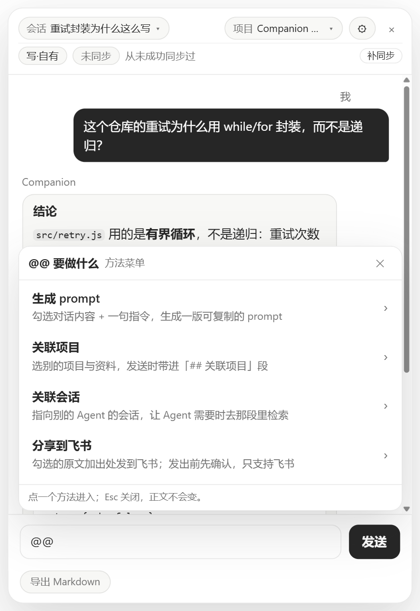
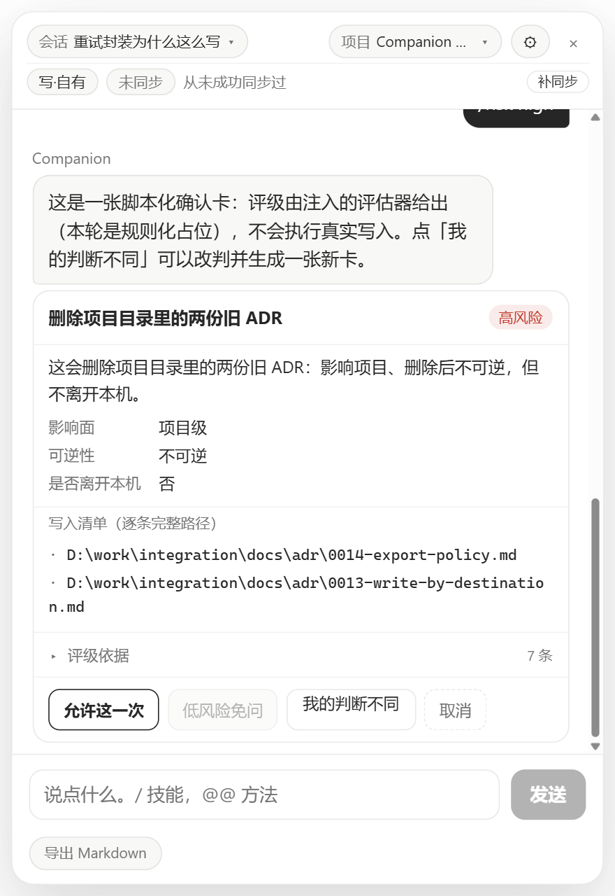

# Owner Companion

**多项目、非侵入式的本地 AI 观察员。** 只读地理解你的仓库，把结论沉淀成项目记忆；所有写操作按目的地分级，跨出本机一律先问人。

<p>
  
  
  
  
  
</p>


> 一个窗口，一个输入框。`/` 调技能，`@@` 先指认对象。没有档位切换，也没有第二个菜单。

---

## 它解决什么

- **项目多，上下文散。** 每个仓库的决策、踩坑、变更理由都留在各自的聊天记录里，换一个项目就得从头解释。
- **不想让 Agent 碰仓库。** 大多数工具默认能写文件；这里默认只读，写入是例外，而且按目的地分级。
- **不想把项目记忆上传。** 数据留在本机 `%APPDATA%\owner-agent-mvp`；跨设备同步只走你自己的私有 GitHub 仓库。

**它不做什么：** 不派发任务、不改被观察的仓库、不自动提交 PR、不做多租户 SaaS。

## 核心设计

### 单入口卡片

| 输入 | 含义 |
| --- | --- |
| `/` | 调用技能。全部技能按名字检索，名字前缀优先；选中后只把技能名填进输入框 |
| `@@` | 先指认对象，再选方法：生成 prompt、关联项目、关联会话、分享到飞书 |
| 普通文本 | 交给只读 Pi 会话回答，逐字流式显示，随时可停 |

### 写入按目的地分级（ADR-0012）

| 目的地 | 行为 |
| --- | --- |
| 自己的记忆库 | 直接执行，给回执 |
| 被观察的项目目录 | 每次确认；同一会话可授权，换会话重新问 |
| 本机之外（飞书） | 每次确认，没有「以后不用问」 |
| 删除 | 永远逐条确认，没有批量放行 |

判定只有一张表（`src/write-gate.mjs`）：未知目的地一律拒绝；删除先于目的地判断。

### 只读的对话后端

对话走 Pi SDK 的只读会话，工具面固定为 `read / grep / find / ls`（外加按需取技能正文的 `skill`）。
创建后再核对一次实际工具表，越权或列不出来直接中止；每次会话一个临时 `agentDir`，不加载全局扩展与项目 `.pi`。
**全局会话也是独立的一条会话**，工作目录是自有目录：能问，但读不到任何项目文件。

### 流式与插入

```text
turn-start → delta*（50ms 合并）→ turn-done（权威全文）
                     ├─ turn-aborted（保留已产出部分）
                     └─ turn-error（分类 + 是否可重试）
```

流式中再发一句有两种方式：**引导**（`streamingBehavior=steer`，插进当前回答）或**中止**（停当前一轮，自动接着发这一句）。思考过程默认折叠，且不写入会话。

### 项目记忆与同步

- 项目库按四类聚合：架构图/图谱、经验、决策、画像；
- 发布走 `/发布` → `/发布 确认`，产出 vN、导出目录与投递回执；
- 同步先拉后推；有冲突就停下，四种处理（远端覆盖 / 本地覆盖 / 两段都留 / 跳过），跳过只影响该篇并留「未解决」标记（ADR-0013）。

## 截图

| `/` 技能：按名字检索 | 选中技能：胶囊 + 只留问题 |
| --- | --- |
|  |  |

| `@@` 方法菜单 | 项目胶囊 |
| --- | --- |
|  |  |

| 写入确认卡：三轴 + 逐条路径 | 模型接口：从已装模型里选 |
| --- | --- |
|  |  |

## 快速开始

**要求**：Windows、Node.js ≥ 22.13、可用的模型凭据（Pi 登录态或 provider 环境变量）。

### 用发布的便携版

从 [Releases](https://github.com/GeTitDD/owner-agent-mvp/releases) 下载 `OwnerCompanion-<version>-portable.exe`，双击即用；数据写在 `%APPDATA%\owner-agent-mvp`。
发布前没有代码签名，SmartScreen 可能提示「未知发布者」；校验 `SHA256SUMS.txt` 后再运行。

### 从源码运行

```powershell
git clone https://github.com/GeTitDD/owner-agent-mvp.git
cd owner-agent-mvp
npm install
npm run desktop
```

### 自己打包

```powershell
npm run desktop:pack     # dist-companion/OwnerCompanion-<version>-portable.exe
```

完整说明（备份、升级、为什么桌面客户端不做容器化）见 [docs/DEPLOYMENT.md](docs/DEPLOYMENT.md)。

> 不提供 Docker 镜像：客户端依赖真实桌面会话、本机绝对路径与宿主机的 Pi 登录态；
> 容器化会同时失去窗口/托盘、写入目的地边界与密钥隔离。要做「一台机器常驻、多端访问」，
> 正确形态是拆出无 GUI 的 sidecar 服务，而不是给 Electron 套 Dockerfile。

首次启动：

1. 顶栏「会话」新建一个会话；
2. 顶栏「项目」选一个已登记项目（或在 `ownerctl` 里登记）；
3. 顶栏 ⚙ → **主模型**：从已装模型里选，或手填 `provider/model`；
4. 直接提问。

模型来自 [Pi](https://github.com/badlogic/pi-mono) 的目录与凭据：

```text
~/.pi/agent/auth.json          provider 登录态
~/.pi/agent/models*.json       provider/model 清单
DEEPSEEK_API_KEY 等环境变量     没有登录态时的兜底
```

> 没有配模型时不会编答案：会话会返回明确的 `no-model` 提示。

## 数据放在哪

```text
%APPDATA%\owner-agent-mvp\
├─ owner.sqlite        项目、会话、任务、观察事件
├─ knowledge.sqlite    知识库
├─ companion.json      配置（不含密钥）
├─ exports\            已发布版本的导出
└─ global-chat\        全局会话的只读工作目录
```

密钥只从环境变量或 `~/.pi` 读取，**不写入 `companion.json`，也不回显在界面里**。

## 架构

```text
desktop/                  Electron 主进程与渲染层（单入口卡片）
├─ shell.js               装配层
├─ shell-header.cjs       顶栏：会话、项目、写范围、同步
├─ shell-compose.cjs      输入区：发送、/ 面板、@@ 面板、命令分派
├─ shell-stream.cjs       对话流：消息、Markdown、流式、勾选、撤回
├─ shell-markdown.cjs     Markdown → DOM（不拼 innerHTML）
├─ shell-at*.cjs          @@ 方法与四个方法卡
├─ shell-config.cjs       配置箱（七分区 + 来源标注）
└─ risk-card.cjs          写入确认卡与三轴判据

src/
├─ write-gate.mjs         写入判定（唯一一张表）
├─ pi-chat.mjs            只读 Pi 会话、流式事件、撤回
├─ watch/                 监控：对象、心跳、定时整理、三类采集
├─ memory/                同步计划、执行、离线状态
└─ setup-probe.mjs        /setup 探测与写盘清单

docs/adr/                 0011 单入口卡片 · 0012 写入按目的地 · 0013 同步冲突交人
```

## 安全边界

- 工具面只读；写入必须过 `write-gate` 与确认卡；
- 外发与删除没有「免问」，删除没有批量；
- 评估器不可用 / 超时 / 缺字段 → 一律按高风险，人工可改判且改判进会话；
- 本地服务只绑定 loopback；审批令牌只留在主进程；
- 未配置模型、配置读不到、技能扫描失败——都显式说明，不静默降级。

## 开发

```powershell
npm test                  # 全部单元测试（不联网、不调模型）
npm run check             # 语法检查（清单驱动）
npm run desktop           # 启动客户端
npm run e2e:desktop:card-shell
```

端到端测试用离屏 Electron + CDP；对话相关用例走 `OWNER_AGENT_CHAT_FAKE=1` 的假流，不依赖凭据与网络。

设计文档：`docs/STREAMING_AND_STREAM_STATES.md`、`docs/adr/`、`GLOSSARY.md`。
贡献方式见 [CONTRIBUTING.md](CONTRIBUTING.md)；安全问题见 [SECURITY.md](SECURITY.md)。

## 已知未完成

- 风险评估目前是规则占位，尚未接模型（#133）；
- 版本浏览与 diff、删除项目、灵感收件箱仍待接回新入口（#92 / #93 / #94 / #96 / #97）；
- 监控心跳目前显式触发，未做常驻调度；
- 同步只覆盖自有私有仓库，未做多端冲突的自动合并（本来也不打算做）。

早期版本（v0.2–v1.0）的说明保留在 [docs/LEGACY_README.md](docs/LEGACY_README.md)。

## 许可

[PolyForm Noncommercial 1.0.0](LICENSE)：源码可见、可自用与修改，**禁止商业使用**。

严格说这不算 OSI 定义的开源（OSI 不接受按使用领域设限），准确说法是 **source-available**。商用授权请单独联系。
