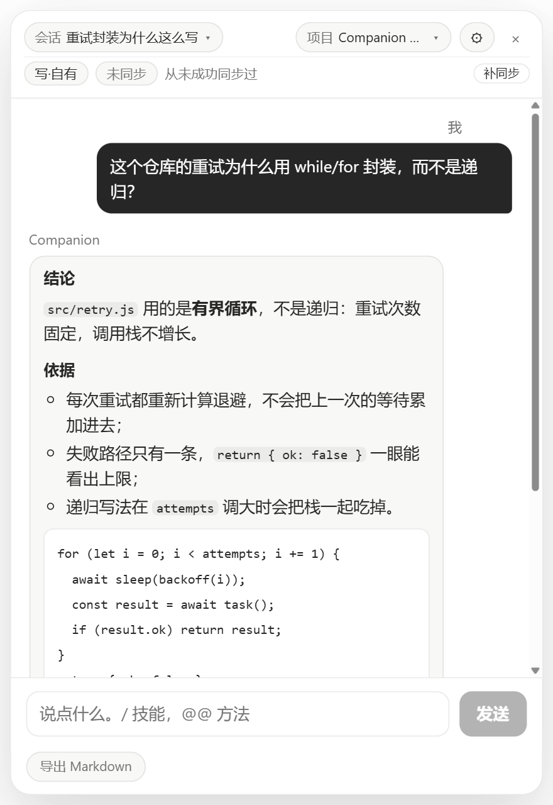
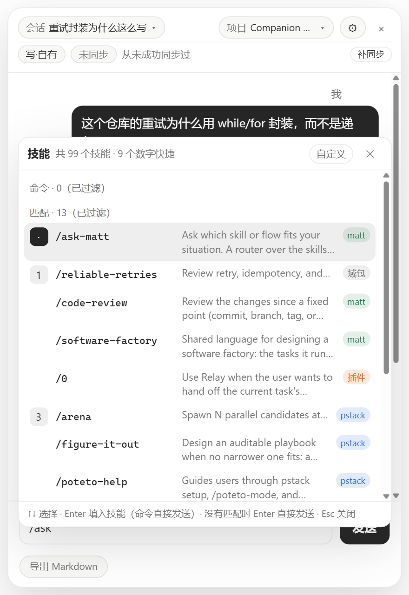
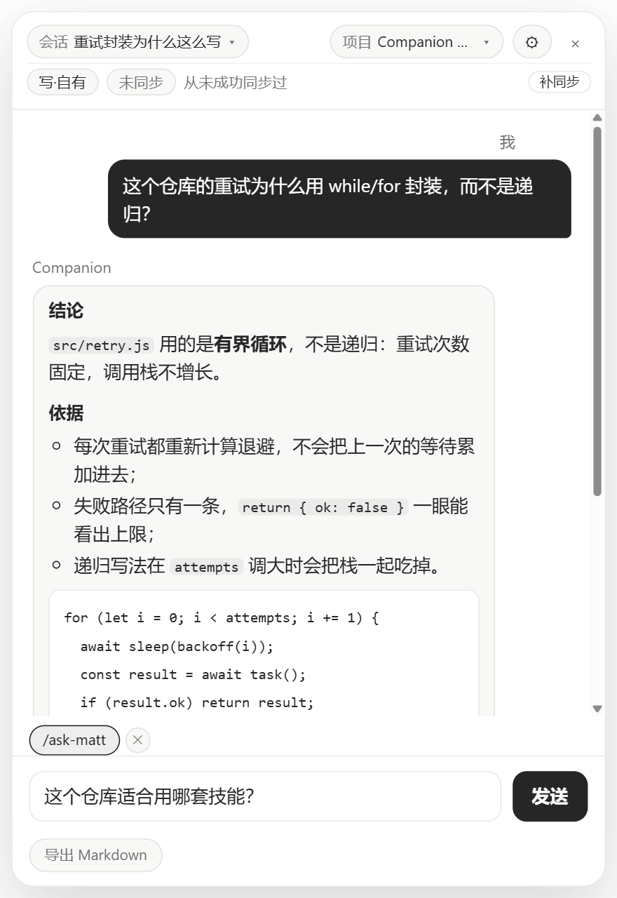
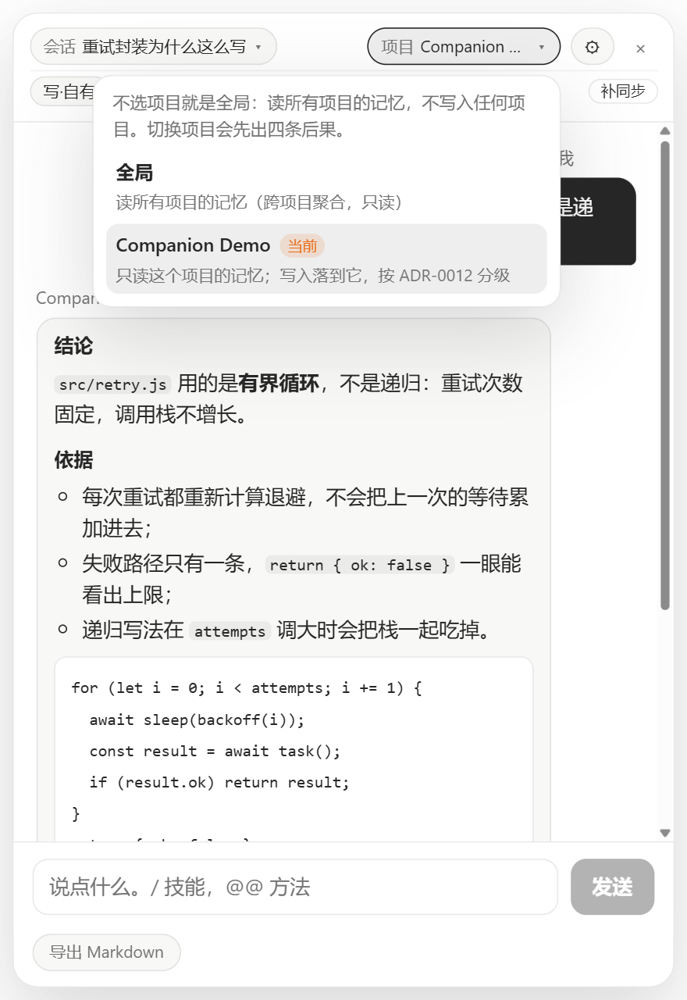
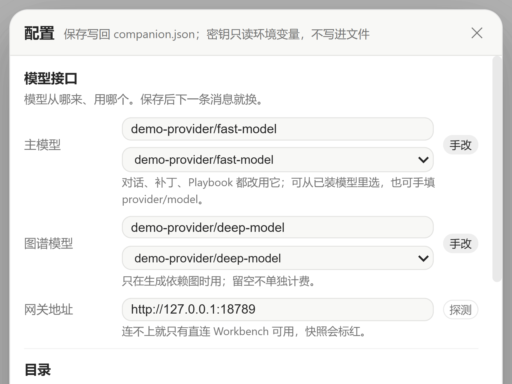

# Owner Companion

**多项目、非侵入式的本地 AI 观察员。** 只读地理解你的仓库，把结论沉淀成项目记忆；所有写操作按目的地分级，跨出本机一律先问人。

<p>
  
  
  
  
  
</p>



> 一个窗口，一个输入框。`/` 调技能，`@@` 先指认对象。没有档位切换，也没有第二个菜单。

---

## 最新更新

### 2026-11-27

- 支持从 GitHub 添加项目：打开已登记项目、关联本机副本，或下载到新目录后进入项目；失败与取消可恢复。
- 改善多项目切换和长会话阅读，分别保留会话范围、未发送草稿、历史记录与完整导出内容。
- 模型设置保存后从下一问生效；连接失败可重试或取回原问题，避免丢失输入。
- 完善灵感、经验和知识的审阅与复用，支持完整正文、适用范围和来源核对，并清楚区分提供资料与实际采纳。
- 支持先预览、再确认的私有 GitHub 记忆同步；冲突可选择本机、远端、都保留或暂时跳过。
- 应用自带 pstack 53 项和 Matt Pocock 39 项技能；slash 选择与手输统一显示蓝色来源标签，同名技能明确区分来源。
- 更换动漫头像应用图标，内置 Petdex 安装量快照前 50 的动画桌宠及 10 个 Cindy 模板，支持搜索、即时切换和重启保存。
- 新增统一的“外观与桌宠”入口，可从配置或桌宠右键打开；优化深色、小窗口、错误提示和取消操作。

[完整更新记录](docs/releases/release-notes.md)

## 它解决什么

- **项目多，上下文散。** 每个仓库的决策、踩坑、变更理由都留在各自的聊天记录里，换一个项目就得从头解释。
- **不想让 Agent 碰仓库。** 大多数工具默认能写文件；这里默认只读，写入是例外，而且按目的地分级。
- **不想把项目记忆上传。** 数据留在本机 `%APPDATA%\owner-agent-mvp`；跨设备同步只走你自己的私有 GitHub 仓库。

**它不做什么：** 不派发任务、不改被观察的仓库、不自动提交 PR、不做多租户 SaaS。

## 核心设计

### 单入口卡片

| 输入 | 含义 |
| --- | --- |
| `/` | 优先显示随应用自带的技能；中文应用命令可展开或直接搜索。选中技能显示蓝色来源标签，问题单独输入 |
| `@@` | 先指认对象，再选方法：生成 prompt、关联项目、关联会话、分享到飞书 |
| 普通文本 | 交给只读 Pi 会话回答，逐字流式显示，随时可停 |

输入 `/记灵感` 可发现记录入口，补充内容后再发；`/记忆同步`、`/同步` 和 `/sync` 打开真实记忆同步设置。
菜单中的「发布确认」也只填入命令，下一次明确发送才执行。

应用自带固定版本的 **pstack 53 项**与 **Matt Pocock 39 项**技能，保留原始名称、正文、参考文件、来源版本与许可证；不需要先在本机安装 Pi 技能或配置目录。默认不扫描个人技能目录，显式配置的外部目录仍可扩展。

技能目录与只读对话使用同一份身份。手输或粘贴 `/技能名 `（空格后补充问题）也会选中蓝色标签；发送后消息仍保留技能来源。同名技能须按来源选择，未知命令保留原文并提示，不会静默当作普通模型问题。
缺失、空正文及 Playbook-only 条目仍能看见原因，但不能选为对话技能。目录支持原位刷新/重试，配置的技能根目录优先于环境默认值。
数字快捷键占用时交换；旧版本已保存的重复数字会提示处理，不能默认调用第一条。刷新和切换会话不会覆盖草稿。
选择技能仍通过只读模型会话处理，不会安装插件、增加写入或执行工具；超过 6000 字的技能正文会明确标注截断。

外观入口：**齿轮 → 外观与桌宠**，也可右键桌宠。应用自带 **Petdex 安装量前 50 的真实动画包 + 10 个 Cindy 模板**，默认显示 Boba，支持按名称/排名搜索、即时切换及重启恢复。动漫应用图标同时用于 Dock、窗口/托盘与 macOS/Windows 构建；[模板与来源说明](docs/MASCOT_PACK.md)。

### 写入按目的地分级（ADR-0012）

| 目的地 | 行为 |
| --- | --- |
| 自己的记忆库 | 直接执行，给回执 |
| 被观察的项目目录 | 每次确认；同一会话可授权，换会话重新问 |
| 本机之外（飞书） | 每次确认，没有「以后不用问」 |
| 删除 | 永远逐条确认，没有批量放行 |

判定只有一张表（`src/write-gate.mjs`）：未知目的地一律拒绝；删除先于目的地判断。

### 只读的对话后端

对话走 Pi SDK 的只读会话，工具面固定为 `read / grep / find / ls`（外加按需取技能正文的 `skill`）。
创建后再核对一次实际工具表，越权或列不出来直接中止；每次会话一个临时 `agentDir`，不加载全局扩展与项目 `.pi`。
**全局会话也是独立的一条会话**，工作目录是自有目录：能问，但读不到任何项目文件。

### 流式与插入

```text
turn-start → delta*（50ms 合并）→ turn-done（权威全文）
                     ├─ turn-aborted（保留已产出部分）
                     └─ turn-error（分类 + 是否可重试）
```

流式中再发一句有两种方式：**引导**（`streamingBehavior=steer`，插进当前回答）或**中止**（停当前一轮，自动接着发这一句）。思考过程默认折叠，且不写入会话。

### 项目记忆与同步

- 项目库按四类聚合：架构图/图谱、经验、决策、画像；
- `/记灵感` 的回执可整理经验：先审阅现象/机制/对策，再审阅知识正文、适用条件、例外和项目/领域范围，两次确认后沉淀；长正文不再被短标题代替，表单草稿保存在本机。
- `/经验 <关键词>` 与普通提问共用项目/领域召回；回复显示本轮实际引用的知识 ID、修订与状态。`@@` 关联的经验会把实际正文带入 prompt。正文过长、未命中与待验证状态均明确标注。
- 真实项目回放、旧实验数据兼容和视觉证据见 [经验链路修复验收](docs/reviews/2026-11-27-experience-repair-delivery.md)；本批未追加真实模型调用，不将本机协议回复当作模型语义质量验证。
- 发布走 `/发布` → `/发布 确认`，产出 vN、导出目录与投递回执；
- 项目菜单默认继续目标项目最近的独立会话，恢复各自的历史和草稿；跨项目查看用「在本会话查看」，确认后才改变本会话范围。
- 桌面已接入知识、决策与经验的逐文档同步：设置自有私有 GitHub 仓库 → 检查清单 → 展开正文与逐篇选择 → 确认后先拉再推。冲突支持远端 / 本机 / 都留 / 跳过；跳过保留未解决标记，远端移除转为可恢复归档（ADR-0013）。

### 设置跨设备同步

1. 安装 Git；在启动应用的环境中配置 `GITHUB_TOKEN` 或 `GH_TOKEN`。令牌需能读取当前用户身份、读取目标私有仓库与推送内容；不在应用或配置文件中输入令牌。
2. 点「设置同步」（或配置 → 同步），填写自己的 `用户名/私有仓库名` 与分支，保存。新分支会在首次确认推送时建立；应用不代建 GitHub 仓库。
3. 点「检查同步」只生成预览。核对篇数、项目归属、正文及证据摘录，冲突逐篇四选一；勾选确认后才会应用接收/归档并传输到远端。
4. 离线、预览过期或任一侧又有修改时，重新检查后继续；取消或关闭设置不会清空聊天草稿。远端移除的文档可在同一区域「查看可恢复归档」中恢复到本机。

当前范围是知识（含决策）和经验及所需证据。应用配置、凭据、原始聊天、执行审计、被观察项目文件不参与这条同步；机器根路径不会自动登记。
已同步的项目 ID 在另一台未登记时保留原归属并提示，不猜测或自动绑定本机目录。
结构化机器路径会省略或转换为稳定引用；记忆正文与证据摘录保留原文，请在确认前核对。

本机事实仍由当前 SQLite 存储持有，远端 Markdown 是传输投影，不是第二份独立可编辑的本机事实。
每篇上限 1 MiB，完整清单上限 10000 篇 / 64 MiB；超限会明确停止，不截断内容。
正常运行会验证仓库自有、私有且可写，并使用非强制推送保护并发修改。
验收使用两份真实 SQLite + 隔离 bare Git 远端，未使用个人凭据或真实 GitHub 账号；GitHub 网络与 Windows 真机仍待独立验收。

## 截图

| `/` 技能：按名字检索 | 选中技能：胶囊 + 只留问题 |
| --- | --- |
|  |  |

| `@@` 方法菜单 | 项目胶囊 |
| --- | --- |
|  |  |

| 写入确认卡：三轴 + 逐条路径 | 模型接口：从已装模型里选 |
| --- | --- |
|  |  |

## 快速开始

**要求**：Windows、Node.js ≥ 22.13、可用的模型凭据（Pi 登录态或 provider 环境变量）。

### 用发布的便携版

从 [Releases](https://github.com/GeTitDD/owner-agent-mvp/releases) 下载 `OwnerCompanion-<version>-portable.exe`，双击即用；数据写在 `%APPDATA%\owner-agent-mvp`。
发布前没有代码签名，SmartScreen 可能提示「未知发布者」；校验 `SHA256SUMS.txt` 后再运行。

### 从源码运行

```powershell
git clone https://github.com/GeTitDD/owner-agent-mvp.git
cd owner-agent-mvp
npm install
npm run desktop
```

### 自己打包

```powershell
npm run desktop:pack     # dist-companion/OwnerCompanion-<version>-portable.exe
```

完整说明（备份、升级、为什么桌面客户端不做容器化）见 [docs/DEPLOYMENT.md](docs/DEPLOYMENT.md)。

> 不提供 Docker 镜像：客户端依赖真实桌面会话、本机绝对路径与宿主机的 Pi 登录态；
> 容器化会同时失去窗口/托盘、写入目的地边界与密钥隔离。要做「一台机器常驻、多端访问」，
> 正确形态是拆出无 GUI 的 sidecar 服务，而不是给 Electron 套 Dockerfile。

首次启动：

1. 首次打开会自动准备会话，可以直接输入；
2. 点击「添加第一个项目」选择本地目录，或选「从 GitHub 添加」；之后两种入口都在顶栏「项目」菜单里，本机登记不改动项目文件；
3. 顶栏 ⚙ → **主模型**：从已装模型里选，或手填 `provider/model`；
4. 直接提问。

回来查看项目时，可以从全局定位屏点击「待确认」直接审核已有候选，点击「未读」查看具体
提交与文件；点击项目名称恢复该项目最近的独立会话。仅切换或查看候选不会清除未读，
各会话草稿也会分别保留。审核卡会先展示正文、适用范围与证据，接受后才写入知识库。

从 GitHub 添加时，粘贴仓库主页链接或 `用户名/仓库名`，点击「检查链接」。已经登记的仓库
可直接打开已有项目；已下载但未登记的，选择「关联本机已有目录」核对 origin；本机没有的，
选择保存位置和新文件夹名称，再点「下载并添加」。下载需要本机 Git，可使用既有 Git/GitHub 凭据。
失败或取消保留表单输入，下载完成后才登记；不覆盖同名目录，不执行安装、构建或项目脚本。
项目菜单会分别显示 GitHub 来源与本机路径；添加项目不配置或触发记忆同步。
首版不提供账号登录界面或仓库列表，访问失败时按提示检查仓库权限与本机凭据。

模型来自 [Pi](https://github.com/badlogic/pi-mono) 的目录与凭据：

```text
~/.pi/agent/auth.json          provider 登录态
~/.pi/agent/models*.json       provider/model 清单
DEEPSEEK_API_KEY 等环境变量     没有登录态时的兜底
```

> 没有配模型时不会编答案：会话会返回明确的 `no-model` 提示。

主模型留空表示暂不连接模型。配置箱会从 Pi 本地目录列出模型并检测凭据状态；保存配置
不代表连接已经验证。提问失败后，可直接从回复下方打开「模型设置」或「重试原问题」，
不必重新输入，重试也不会覆盖正在编辑的下一条草稿。

## 数据放在哪

```text
%APPDATA%\owner-agent-mvp\
├─ owner.sqlite        项目、会话、任务、观察事件
├─ knowledge.sqlite    知识库
├─ companion.json      配置（不含密钥）
├─ exports\            已发布版本的导出
└─ global-chat\        全局会话的只读工作目录
```

密钥只从环境变量或 `~/.pi` 读取，**不写入 `companion.json`，也不回显在界面里**。

## 架构

```text
desktop/                  Electron 主进程与渲染层（单入口卡片）
├─ shell.js               装配层
├─ shell-header.cjs       顶栏：会话、项目、写范围、同步
├─ shell-compose.cjs      输入区：发送、/ 面板、@@ 面板、命令分派
├─ shell-stream.cjs       对话流：消息、Markdown、流式、勾选、撤回
├─ shell-markdown.cjs     Markdown → DOM（不拼 innerHTML）
├─ shell-at*.cjs          @@ 方法与四个方法卡
├─ shell-config.cjs       配置箱（七分区 + 来源标注）
└─ risk-card.cjs          写入确认卡与三轴判据

src/
├─ write-gate.mjs         写入判定（唯一一张表）
├─ pi-chat.mjs            只读 Pi 会话、流式事件、撤回
├─ watch/                 监控：对象、心跳、定时整理、三类采集
├─ memory/                同步计划、执行、离线状态
└─ setup-probe.mjs        /setup 探测与写盘清单

docs/adr/                 0011 单入口卡片 · 0012 写入按目的地 · 0013 同步冲突交人
```

完整说明见 [docs/ARCHITECTURE.md](docs/ARCHITECTURE.md)：运行时拓扑、IPC 边界、四条关键链路、数据布局与已知缺口。

## 安全边界

- 工具面只读；写入必须过 `write-gate` 与确认卡；
- 外发与删除没有「免问」，删除没有批量；
- 评估器不可用 / 超时 / 缺字段 → 一律按高风险，人工可改判且改判进会话；
- 本地服务只绑定 loopback；审批令牌只留在主进程；
- 未配置模型、配置读不到、技能扫描失败——都显式说明，不静默降级。

## 开发

```powershell
npm test                  # 全部单元测试（不联网、不调模型）
npm run check             # 语法检查（清单驱动）
npm run desktop           # 启动客户端
npm run e2e:desktop:card-shell
npm run e2e:desktop:memory-sync  # 两份真实存储 + 隔离 Git；不连个人仓库
npm run e2e:desktop:skill-discovery  # 真实 SDK + 本机 HTTP 夹具；不连接收费模型
```

端到端测试用离屏 Electron + CDP；对话相关用例走 `OWNER_AGENT_CHAT_FAKE=1` 的假流，不依赖凭据与网络。

设计文档：`docs/STREAMING_AND_STREAM_STATES.md`、`docs/adr/`、`GLOSSARY.md`。
贡献方式见 [CONTRIBUTING.md](CONTRIBUTING.md)；安全问题见 [SECURITY.md](SECURITY.md)。

## 已知未完成

- 风险评估目前是规则占位，尚未接模型（#133）；
- 版本浏览与 diff、删除项目、灵感收件箱仍待接回新入口（#92 / #93 / #94 / #96 / #97）；
- 监控心跳目前显式触发，未做常驻调度；
- 跨设备同步主路径已接入并完成隔离远端验收；真实 GitHub 账号/网络与 Windows 真机尚未验收，项目 ID 到本机目录仍需用户登记，损坏基线的引导恢复待补。

早期版本（v0.2–v1.0）的说明保留在 [docs/LEGACY_README.md](docs/LEGACY_README.md)。

## 许可

[PolyForm Noncommercial 1.0.0](LICENSE)：源码可见、可自用与修改，**禁止商业使用**。

严格说这不算 OSI 定义的开源（OSI 不接受按使用领域设限），准确说法是 **source-available**。商用授权请单独联系。
