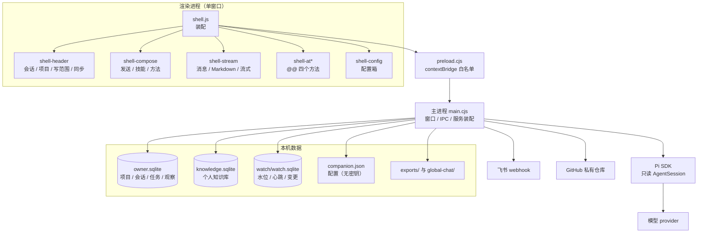
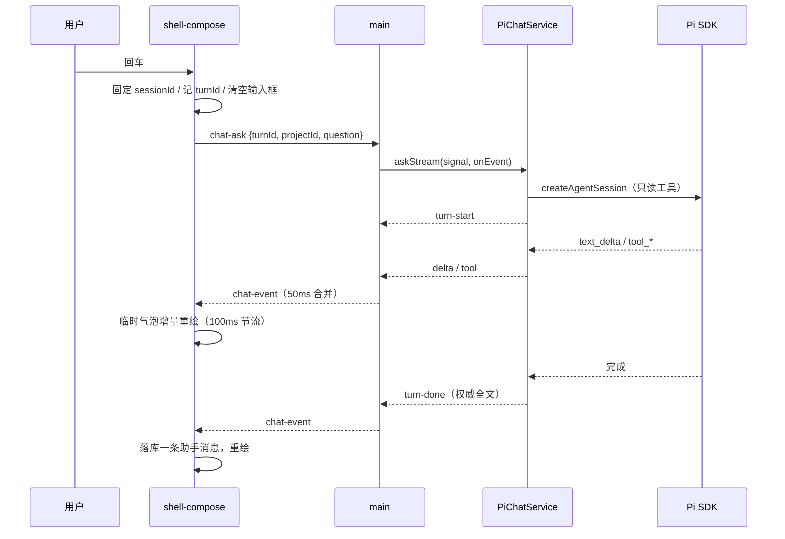
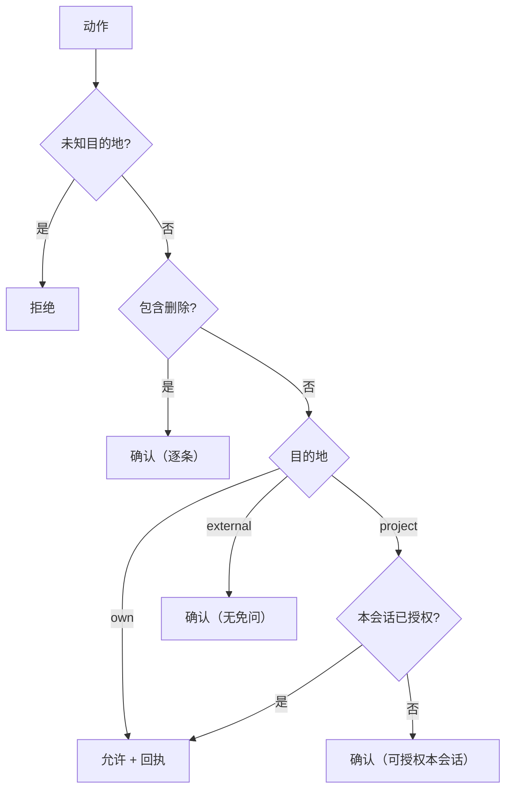
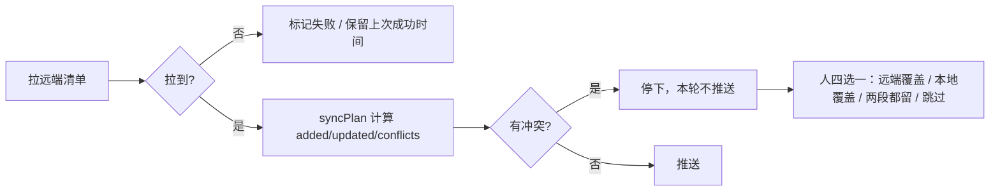

# 架构

本文描述**当前**（卡片壳 + 只读 Pi 会话）的实现结构，不覆盖 v1.0 之前的旧面板。
决策依据见 `docs/adr/`，产品口径见根目录 `README.md`。

## 1. 定位与不变量

这个系统的边界比功能更重要。下面几条是架构约束，不是建议：

| 不变量 | 含义 | 落在哪 |
| --- | --- | --- |
| 观察层只读 | 对话工具面只有 `read / grep / find / ls`（+ `skill`） | `src/pi-chat.mjs` 注册后二次核对 |
| 写入按目的地 | 自有目录直接写；项目目录确认；外发/删除恒确认 | `src/write-gate.mjs`（唯一判定表） |
| 同一条事实只存一处 | 其余位置只存指针 | ADR-0002；`src/memory/session-pointer-index.mjs` |
| 冲突交人 | 同步不自动合并、不宣告真相源 | ADR-0013；`src/memory/sync-run.mjs` |
| 失败显式 | 没模型、读不到、越权都写清原因，不静默降级 | `pi-chat` / `sync-status` / `setup-probe` |

## 2. 运行时拓扑



要点：

- **渲染层不直接碰 Node**：所有能力经 `preload.cjs` 的 `companion.*` 白名单进入主进程；
- **窗口只有一个主壳**（`shell.html`），另有桌宠 `pet.html`、可选的全窗与观察窗；
- **本地 HTTP 不是主路径**：`src/sidecar-server.mjs` 是给 OpenClaw Control UI 用的可选边界，
  `bin/workbench.mjs` 是 v0.4 的本地 Web 控制台（保留、不在主流程）。

## 3. 进程与窗口

### 主进程（`desktop/main.cjs`，约 5k 行）

职责按启动顺序：

```text
单实例锁 / 托盘 / 显示模式
  → 读 companion.json（无密钥）
  → OwnerStore(owner.sqlite) / PersonalKnowledgeStore(knowledge.sqlite)
  → ChatSessionStore（复用 owner 库连接）
  → 创建窗口：panel（shell.html）/ pet / full / observer
  → 注册 IPC（101 个 companion:* 通道）
  → 可选：sidecar HTTP、mobile 服务
```

窗口是无边框的：顶栏 `-webkit-app-region: drag` 负责拖动，右上角只有「收起」，退出在托盘菜单。

### 渲染层

`shell.js` 只做装配：创建各块、接共享上下文（`ctx`）、按启动顺序读一次库。
四块职责固定：

| 文件 | 职责 | 不做什么 |
| --- | --- | --- |
| `shell-header.cjs` | 会话列表与切换、项目范围、写范围文案、同步状态 | 不发送消息、不判定写入 |
| `shell-compose.cjs` | 输入框、发送、`/` 面板、`@@` 面板开合、命令分派 | 不画消息、不判风险 |
| `shell-stream.cjs` | 消息渲染、Markdown、流式气泡、勾选、复制、撤回按钮 | 不决定发什么 |
| `shell-at*.cjs` | `@@` 容器与四个方法卡的内容 | 不改会话模型 |

规则模块（可在 Node 里单测）：`shell-thread`、`shell-sessions`、`shell-projects`、
`shell-skills`、`shell-blocks`、`shell-copy`、`shell-markdown`、`risk-card`、`confirm-cards`。

## 4. IPC 与信任边界

通道全部以 `companion:` 开头，按前缀分组：

```text
card-session*      会话 CRUD、追加消息、回答提问块、切换视图
chat-*             提问 / 流式事件 / 中止 / 引导 / 撤回
settings*          配置读写（密钥只读状态）
setup-*            探测与按清单写盘
own-write          自有目录写入
project-sync-*     项目目录清单与写入
share-feishu       外发投递
model-catalog      已装模型清单
skills / session-* 技能目录与会话检索
library-* / project-*  项目库、快照、发布、导出
```

主进程的每个 handler 都做 `fromCompanion(event)` 校验：只接受本应用窗口发来的调用。
流式事件走反方向：`message_update` → 合并 → `companion:chat-event`，渲染层按 `turnId` + `seq` 过滤。

**为什么 `turnId` 由渲染层生成**：切会话、重试、快速连发时，旧事件会迟到；
过滤规则放在渲染层，主进程不需要知道「当前是哪一轮」。

## 5. 关键链路

### 5.1 对话与流式



三个细节：

- **会话键** = `会话id::项目id::根目录::模型`；换模型即丢旧会话（`setModel`）。
- **停止**：渲染层先置「已停止」，再发 `chat-abort`；信号也传给会话创建阶段，创建能被中止。
- **引导**：`streamingBehavior=steer` 插进当前轮；`turn-reset` 清掉已流出的旧文字，最终答案以 steer 后为准。
- **撤回**：`getUserMessagesForForking()` + `navigateTree()` 退回 Pi 会话树，本地删一问一答。

### 5.2 写入判定



实现分工：

| 模块 | 职责 |
| --- | --- |
| `src/write-gate.mjs` | 唯一判定表；`granted` 只认严格 `true` |
| `src/own-write.mjs` | 自有目录执行与回执（不弹卡） |
| `src/project-write.mjs` | 清单、会话授权、取消后文件系统一致 |
| `src/confirm-plan.mjs` | 同一动作里写/删/外发的顺序：**写 → 删除 → 外发** |
| `desktop/risk-card.cjs` | 三轴、判据、失败降 High、人工改判并列追加 |
| `desktop/confirm-cards.cjs` | 外发与删除的卡：外发无「以后不用问」，删除无批量 |

### 5.3 同步



- `syncPlan` 只用 `dirty` / `baseVersion` 判「改没改」，`updatedAt` 只用于展示；
- 跳过只影响该篇，并记 `conflict-skipped`，下次同步仍提示；
- 离线状态是第三份纯模块（`sync-status.mjs`）：`synced / unsynced / unknown`，从未成功同步绝不显示成已同步。

### 5.4 `/setup` 探测与写盘

```text
probe（只读） → 逐项判定（可用/只读/缺失/需新建） → 建议写入清单
  → 一次确认 → apply（只按最近一次清单） → 回执
```

- 手改过的值以 `setupProbed` 为基线判断，重新探测不覆盖；
- 技能目录数量为 0 是「存在但为空」，不是缺失；
- 取消不调用 apply，文件系统前后一致。

## 6. 数据布局

```text
%APPDATA%\owner-agent-mvp\
├─ owner.sqlite          OwnerStore + ChatSessionStore（同一连接）
│   ├─ owner_projects / tasks / events
│   ├─ owner_jobs / attempts / results / runs / workspaces
│   ├─ owner_patch_*, owner_repair_*, owner_sandbox_*
│   ├─ owner_project_briefs / diagrams / knowledge_links / queue
│   ├─ owner_chat_sessions / owner_chat_messages
│   └─ observer_events / observer_digests / observer_deliveries
├─ knowledge.sqlite      PersonalKnowledgeStore
│   ├─ personal_units / personal_revisions
│   └─ personal_domains / personal_proposals
├─ watch\watch.sqlite    监控：水位 / 心跳 / 变更 / 整理
├─ companion.json        配置（不含密钥）
├─ exports\              发布导出（projectId/vN）
├─ global-chat\          全局会话的只读工作目录
└─ conversations\        会话 Markdown 导出（#110）
```

**单一事实来源**：项目、会话、任务、观察事件都在 `owner.sqlite`；
`knowledge.sqlite` 只放知识单元与领域/提案；`watch` 状态全部外置，项目目录零写入。

## 7. 监控与记忆

```text
监控对象（只认三类）：project / session / github
  ├─ 心跳：只收集，不读内容（watermark → 变更计数）
  └─ 定时整理：理解变更 → 产出候选（需要人接受才入库）
```

- 对象校验在 `src/watch/target.mjs`：未知类型、缺字段一律拒绝，不做「猜一个默认」；
- 采集器按类型分开：`collect-project / collect-session / collect-github / collect-result`；
- 会话扫描同时服务两处：`@@ 关联会话` 的指针索引（#125）与决策候选（历史能力）。

## 8. 扩展点

| 扩展 | 方式 | 注意 |
| --- | --- | --- |
| 技能来源 | `pstack` / `matt` / 域包 manifest / 插件 | 面板只显示技能名；调用按目录名映射回 Pi |
| 模型 | Pi 的 `models.json` / `models-store.json` | 配置箱只列 provider/model，不显示密钥 |
| 内置命令 | `BUILTIN_COMMANDS`（`shell-compose.cjs`） | 命令没有数字号，避免占用技能别名 |
| 写入目的地 | 只能改 `write-gate.mjs` 一张表 | 改表必须同时改确认卡与测试 |
| 同步后端 | 注入 git 执行器与文件读写 | 执行器不读网络、测试全用假实现 |

## 9. 已知架构缺口

- `desktop/main.cjs` 仍是单文件（约 5k 行），窗口、IPC、服务装配混在一起；
  下一步应按「窗口 / IPC 注册 / 服务装配」拆三块，而不是继续加函数。
- `shell-header.cjs` 已承担五件事（会话、项目、写范围、同步、全局聚合），有继续膨胀的趋势。
- 风险评估器是规则占位（#133），接口已可注入但没接模型。
- 旧面板删除后，版本浏览、删除项目、灵感收件箱等入口待接回（#92/#93/#94/#96/#97）。
- `sidecar-server` / `workbench-server` / `mobile-server` 是历史边界，仍在仓库里但不在主流程；
  README 已标注，后续要么接回产品、要么删除。
- 监控心跳目前显式触发，未做常驻调度。

## 10. 参考

- `docs/adr/0011-single-entry-card.md` — 单入口卡片
- `docs/adr/0012-write-by-destination.md` — 写入按目的地分级
- `docs/adr/0013-sync-conflict-hitl.md` — 同步冲突交人
- `docs/adr/0014-locate-screen.md` — 定位屏取代全局聚合，未读与水位分离
- `docs/adr/0015-experience-view-by-invocation.md` — 经验的查看走调用与隐式检索
- `docs/DIRECTION.md` — 方向对齐：降低多项目开发的认知负担
- `docs/STREAMING_AND_STREAM_STATES.md` — 流式协议与对话流状态
- `docs/DEPLOYMENT.md` — 打包、发布与为什么不做容器
- `GLOSSARY.md` — 领域词汇
