# Owner Companion / Workbench UI 方向 v1

> 目标：把“聊天式界面”升级为“任务委托 + 信任审阅”界面。保留 Cindy 的暖中性、单色 CTA 与低噪音底子，不重做产品能力。


## 1. 参考产品

| 产品 | 借鉴点 |
| --- | --- |
| Goose（本地 Agent，Desktop + CLI） | 权限模式（Auto / Smart / Approve / Chat Only）；写工具内联 Allow / Deny；Recipes 复用工作流 |
| Open WebUI Computer | `ask / auto / full` 审批模式；只读自动放行、写/命令必须批准；Plan Mode 先只读出计划 |
| Cline | Plan / Act 两态；文件修改先看 diff；checkpoint 可回滚；动作级审批 |
| Letta ADE | 左配置 / 中对话 / 右状态；Context Window Viewer、Core Memory、Archival Memory |
| OpenHands | 轨迹/事件流可视化；SecurityAnalyzer 风险分级 + ConfirmationPolicy |
| Khoj / Reor | 本地优先个人知识；搜索 + 阅读 + 来源引用，不用聊天记录代替知识浏览 |
| Setproduct Agent UI Patterns | 可编辑计划、Live Step Ledger、Tool Cards、分级权限、批量审批、暂停改道、Diff-first、Verified/Assumed/Could-not-do、Action Trail |
| Dataiku HITL | 风险分级检查点、审批审计（人/时间/理由）、审批延迟与驳回率指标 |

## 2. 设计原则

1. **任务优先**：一个任务有目标、计划、步骤、审批、结果、审计；聊天只是附属。
2. **先计划后执行**：只读分诊 → 可审阅计划 → HITL → 执行 → 补丁 → 沙箱。
3. **审批按风险分级**：读不打断；写要批准；破坏性/不可逆每次都要批准。
4. **结果先给足迹**：改了哪些文件/知识，按风险排序；再给说明。
5. **诚实结果**：固定三栏 `已验证 / 假设 / 未能完成`，不把“没跑测试”写成“完成”。
6. **可审计**：动作、来源、修订、采纳、冲突都有不可变 ID 与时间。
7. **后台可感知**：全局 pill 区分“运行中”和“需要你”，不能让任务停在看不到的地方。
8. **知识是信任记录**：正文只是一栏；来源、修订、采纳、使用、冲突同等重要。

## 3. 屏幕结构

### 3.1 Companion 首屏（三模式：专注 / 知识 / 对话）

```text
[状态 pill] 0 运行 · 1 待你
[专注] [知识] [对话]        ← 模式栏，只切换视图，不是三套数据

专注（两区：上面操作区，下面工作区）
  操作区（跨项目：现在要你处理什么）
    待办（按项目分组，首组展开；没有待办时整段收起，不留标题与说明）
    运行中（非终态执行：卡住 / 停止中 / 排队 / 执行中；没有时整段收起）
    待提炼（达到阈值的项目；没有时整段收起）
    操作结果下钻：只读分析答案 / 会话记录 / 最近结果（三段都空时整段不出现）
    三类块全空时操作区压成一行文字，不保留卡片外框
  工作区（常驻展开，永远绑定一个项目：这个项目现在是什么样）
    顶部：项目名 + 项目切换标签（只有一个项目时不显示切换）+ 行尾「添加项目」
    四个入口：知识 / 测试 / 补丁 / 运行（只给计数，点击跳到原位置）
    项目画像 / 项目图谱 / 想法 / 知识快捷 / Playbook / 运行中与最近活动
  设置向导（添加项目）在「设置」面板里，不占工作区
  输入框：交办到…（显式选择，未选不放行）+ 一句话 + 发送

知识
  知识浏览（候选 / 经验 / 知识三层；待验证、已验证、已复现、争议是条目上的状态徽章，不是分组；
           每层给出当前项目与全部项目两个口径的计数；空层不占位）
  候选可直接接受或拒绝；经验可「提升为候选」
  技能目录（域包 / pstack / 插件三处合并的只读列表）
  待提炼提议不在这里重复出现，只在专注页操作区

对话
  会话列表（按项目分组，可新建/切换/改名/删除）
  只读问答 + 「交办」开关（默认关；开＝这次发送走审批链路建任务）
```

**视图项目与交办目标是两个状态**：工作区看哪个项目不决定交办写到哪；点工作区顶部的项目标签只换视图，
交办目标只能由输入框左侧的「交办到 …」菜单设置。新建会话也必须先选项目，不做静默预选。

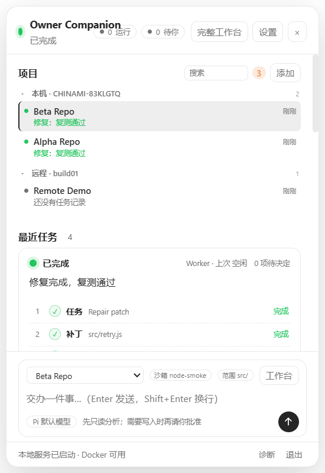

### 3.2 任务详情抽屉

- 目标、项目、类型、风险等级。
- 计划：3–6 步，可编辑（后续版本），当前为只读计划预览。
- 审批：展示写入意图、目标文件、允许范围、只读分析结论。
- 结果：diff 摘要 + 验证/假设/未完成。
- 动作：`去批准` / `拒绝` / `暂停改道`（后续版本）。

### 3.3 知识详情（Workbench）

Tab：`内容 | 修订 | 来源 | 使用 | 冲突`

- 内容：现有编辑表单。
- 修订：时间线 + 旧/新内容对比 + 恢复。
- 来源：`knowledgeId`、采纳修订、Head、漂移、来源版本/哈希/可用性。
- 使用：run、revision、context snapshot、outcome/benefit。
- 冲突：本地/远端/字段；解决入口。
- 维护页：冲突、待重验证、来源、同步状态；后端未启用时明确降级提示。

#### 审核中心（知识变更提案）

- 「完整知识库 → 审核中心」列出所有 `pending` 提案，可直接接受 / 拒绝；
- 提案正文默认按 Markdown 预览渲染（标题 / 列表 / 行内代码 / 代码块），长文默认折叠，可展开全文；
- 提案来源：一键提炼（`harvest`）、复盘（`reflect`）、结构走读（`how`）等 pstack 结果；
- 提案数据存放在知识库（默认 `~/.domain-context/index.sqlite`），桌面版 Owner 数据在 `userData/owner.sqlite`，两者不同库；
- 审核通过才会生成或更新知识条目，拒绝不改动知识库。

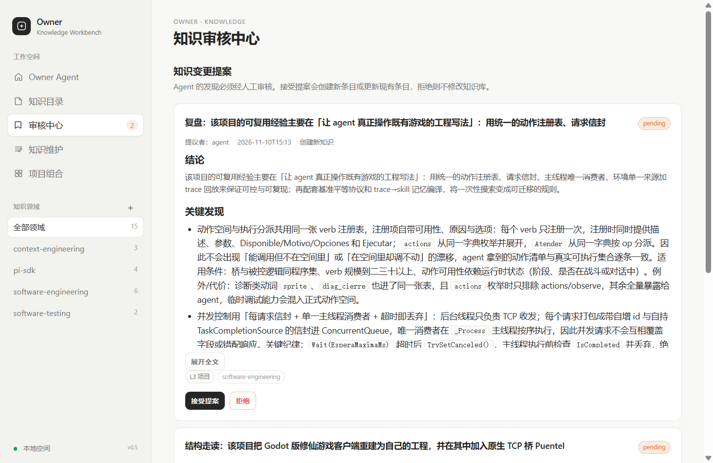

### 3.4 动态桌宠与一键换肤

- 支持 Cindy 静态 PNG/SVG/GIF 与 **Codex Pet 动画包**（`pet.json` + spritesheet，8×9 / 8×11）。
- 宠物直接浮在桌面上，没有白色圆盘或光环，只保留贴地阴影。
- 状态 → 精灵行：idle / running / waiting / review / failed；完成时先 `jumping` 一次再进入 `review`，换皮肤先 `waving` 一次，拖动时按方向播 `running-left/right`。
- pstack 只读分析运行期间，桌宠进入 running 并显示「pstack 正在分析：…」；完成后 3 分钟内显示完成/失败，再回到 idle。
- 每行动作的实际帧数不同（idle 6、waving 4、jumping 5…），只播有效帧，不会闪到行尾透明占位。
- 悬停工具条：`↻` 一键切到下一个皮肤、`▦` 打开皮肤选择、`×` 隐藏。
- 右键桌宠打开皮肤选择；设置页点击任意皮肤立即生效，动画包显示首帧缩略图。
- 「导入 Codex 宠物…」选择 `pet.json` 或文件夹，复制到用户目录并立即切换。

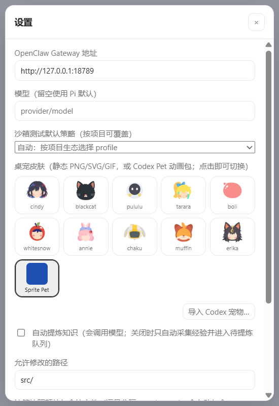

### 3.5 项目查找（按来源主机分类）

> 修订（#73）：本节描述的项目查找页（搜索 + 按来源主机分组的列表 + 添加）已删除；选项目改到工作区顶部的项目切换标签，「添加项目」挂在切换行尾或在设置面板里。以下内容保留为历史参考。

- 顶部第一屏是**项目查找**，不是卡片墙：按项目根路径推断来源主机，分为 `本机 · HOST` 与 `远程 · HOST` 两组（UNC `\\host\share`、`ssh://` / `sftp://` / `git://` 取主机名）。
- 组头可折叠，显示该来源下的项目数；本机组排在最前。
- 每行：状态点 + 项目名 + **最近一次进展**（任务 / 补丁 / 沙箱 / 修复里时间最新的一条）+ **相对时间**（刚刚 / N 分钟前 / N 小时前 / N 天前），悬停可看完整时间与根路径。
- 有待办时显示 `N 待你`，正在执行时显示 `进行中`；视图项目左侧高亮（不代表交办目标）。
- 顶部搜索框按名称 / 路径 / 进展过滤；「添加」直接选择新的项目目录。
- 选中项目后，列表下方展开该项目的 **知识摘要**：
  - 计数：经验 / 知识 / 已验证 / 待提炼 / 候选 / 复用；
  - 条目：已验证知识优先，其次最近经验；点击知识打开详情；
  - 标签：该项目知识的高频标签；
  - 底部：共享知识数量与「提炼 N 条」入口。
- 切换项目时摘要跟着切换，并即时从知识库重新读取。
- 没有待决定事项时不再占用首屏，只在有审批时出现。


### 3.6 pstack 结果沉淀为项目知识

- 所有 playbook 仍然只读：不改文件、不自动开补丁。
- 结果页主操作是「**沉淀为项目知识**」：把结论、关键发现、风险/未知、下一步和证据引用写成一条 **项目级知识候选**。
- 候选状态始终是 `unverified`（`scope=project`、`layer=project`），进入项目知识摘要的「候选」计数；在完整知识库里审核后才可能变为已验证。
- 同一次 run 重复沉淀会自动去重；候选带 `pstack:<runId>` 与文件证据，可回溯。
- 「生成改动提案」降为次要操作，只在确实要改代码/文档时使用，仍然走 HITL 审批。
- 组别对应关系：`分析 / 验证 / 修复 / 沉淀` 都可以沉淀知识；「沉淀」组的复盘、讲清楚、文档体检最适合直接生成候选。
- **一键「复盘并沉淀」**：在「项目 Playbook」标题右侧或「知识」操作栏点击，直接跑 `reflect`（复盘），成功后自动沉淀为知识候选，不需要再手动点一次；失败时保留分析结果并提示原因。
- **预设按钮**：Playbook 标题行的「一键沉淀」提供 4 个预设——`复盘`、`结构走读`、`根因定位`、`怎么验收`；点击后运行对应 playbook 并自动沉淀。知识区保留「复盘并沉淀」快捷入口。


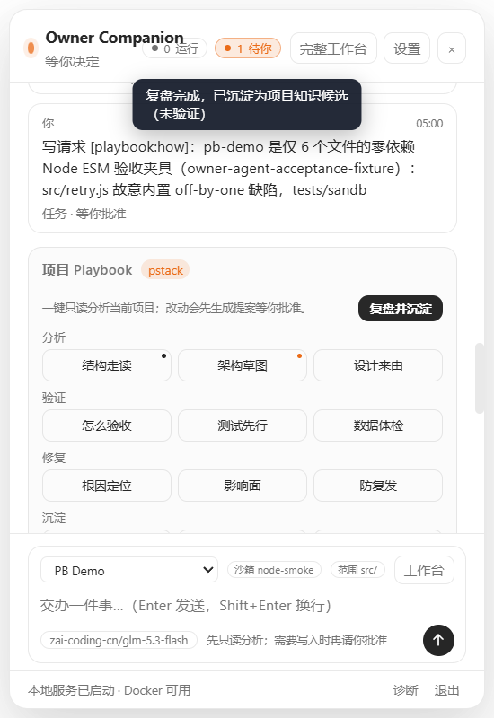

### 3.7 GitHub 关联

- 项目行自动从 `git remote get-url origin` 识别 GitHub 仓库（https / ssh / scp 写法都支持），显示 `GH` 徽章。
- 点击 `GH` 在系统浏览器打开仓库；`GH` 绿色表示 gh 已成功读取状态，`GH?` 表示已关联但状态不可读（悬停看原因）。
- 悬停可看 `owner/repo`、私有/公开、默认分支、星标、最近一次提交。
- 复用本机已登录的 **gh CLI**，不新增 token 存储；未登录时提示 `需要 gh auth login`，仓库链接仍然可用。
- 只读：不读取代码、不改动远端；创建 PR 等写操作暂不包含。
- 状态按项目根目录缓存 5 分钟，避免每次轮询都调用 GitHub。
- 项目下方「GitHub」区列出打开的 Issues / PR（各最多 5 条），点击条目在浏览器打开；显示打开总数（最多统计 20 条，超过显示 `20+`）。
- Issues/PR 列表只读、缓存 2 分钟；仓库不可读时只显示错误与仓库链接，不影响项目切换。


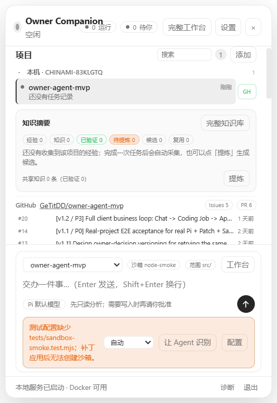

### 3.8 创建 GitHub PR（受控写远端）

只有在 **修复周期 `tested_pass` + 补丁 `applied` + worktree 仍在** 时，结果卡片才出现「创建 PR」。

- 先预览：仓库、`base ← head`、变更文件与 stat、commit message、PR 标题/正文。
- 必须勾选「我确认推送到 GitHub 并创建 Draft PR」才可继续。
- 预览返回 `previewHash`；创建时重算并比对，内容变化（文件、base、head、补丁 hash）会拒绝，必须重新预览。
- 只 `git add` 补丁批准过的文件，不使用 `git add -A`；worktree 出现未批准文件直接拒绝。
- 只推 `owner/` 分支，拒绝 `main` / `master`、路径穿越、远端已存在的同名分支；**绝不 force push**。
- 默认创建 **Draft PR**，不合并；PR 正文写明周期、补丁、测试运行与「不会自动合并」。
- 推送失败不创建 PR；推送成功但 `gh pr create` 失败时保留分支并提示错误。
- 复用本机 `gh` 认证；HTTPS remote 的 `git push` 依赖本机 Git 凭据。

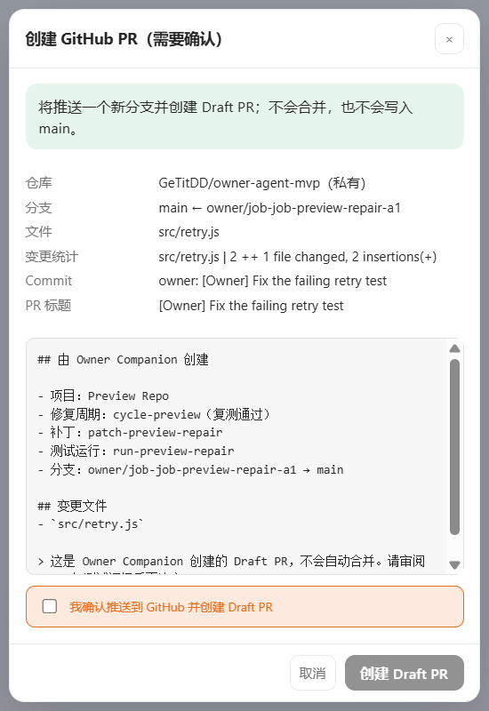

### 3.9 普通用户语义层：理解 / 整理 / 下一步

内部有四条 SOP、pstack、知识闭环和 GitHub，但首页只暴露普通用户能懂的动词：

| 用户动作 | 背后能力 | 输出 |
| --- | --- | --- |
| 一键理解项目 | pstack `how` + 仓库事实 | 项目画像：一句话、怎么跑、关键模块、怎么验收、风险、依据 |
| 一键整理知识 | 重复/需复核/冲突/未验证扫描 | 整理报告；不自动合并或改写 |
| 一键复盘沉淀 | `reflect` + distill | 一条项目知识候选 |
| 一键验收 / 修复 / 交付 | 现有 SOP-2/3 + PR 流程 | 审批、修复循环或 Draft PR |

**项目画像**字段：`一句话 / 它是做什么的 / 怎么跑 / 关键模块 / 代码约定 / 怎么验收 / 风险 / 还不确定 / 依据 / 版本 / 是否过期`。画像按 commit 基线判断过期；代码变化后显示“已过期”。

- **一键理解**：本地扫描 README / package.json / 目录结构 / 测试命令，**不调用模型**，立即出结果；
- **深度理解**：调用 pstack `how` 做模型分析，耗时较长（可取消），成功后会覆盖快速画像；失败时保留快速画像。

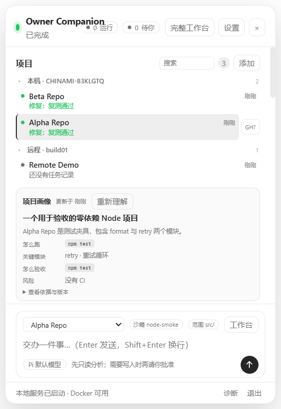

**下一步建议**只显示一个最值得做的动作，优先级为：

```text
待审批 → pstack 运行中 → 画像缺失/过期 → 有待整理知识 → 测试通过可交付 → 失败查看 → 交办新任务
```

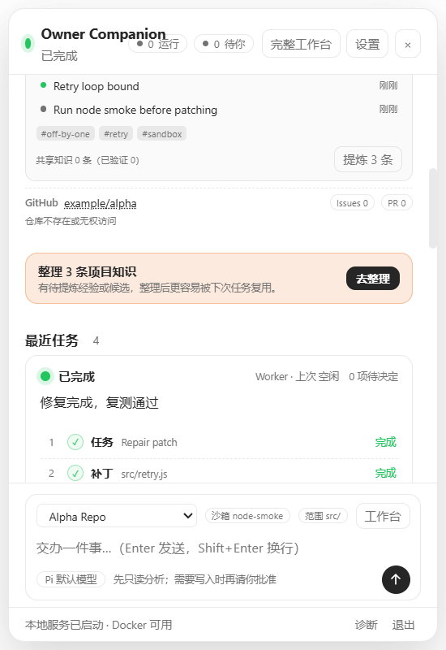

知识整理只做扫描与建议（重复组、需复核、冲突、未验证），合并/复核/批准仍走完整知识库的 HITL。

### 3.10 长任务与稳定性

- pstack / 一键理解在**独立子进程**运行，模型调用不会阻塞 Electron 主进程；面板、桌宠和取消按钮保持可操作。
- 子进程关闭 Monty/Python，并对 git / docker 等外部命令统一 `windowsHide`，不会每次弹出终端窗口。
- 取消会直接终止子进程，返回受控的“执行失败：canceled”，不会留下后台任务。
- 渲染进程 3 秒无响应会自动 reload；未捕获异常写入 `%APPDATA%\owner-agent-mvp\companion-errors.log`。
- 设置页动画皮肤使用 `thumb.png` 首帧缩略图，避免一次解码 100 张大图。

### 3.11 专注页的工作区与想法池

专注页分上下两区：上面是**操作区**（答「现在要你处理什么」，跨项目），下面是**工作区**
（答「这个项目现在是什么样」，永远绑定一个项目、常驻展开）。知识模式不重复这套工作台，
只保留「知识浏览 + 技能目录」。

- **工作区**：顶部只有一处项目切换（项目名 + 标签），切换行尾是「添加项目」；下面是四个入口
  （知识 / 测试 / 补丁 / 运行，带计数）、项目画像、项目图谱、想法、知识快捷、Playbook、
  运行中 / 最近活动。工作区里不再有跨项目的全局区块。
- **操作区**：待办 / 运行中 / 待提炼三类块；操作产生的结果（只读分析答案、会话记录、最近结果）
  落在操作区下方的下钻位置，三段都空时整段不出现，不占位。
- **设置向导**：添加项目向导在「设置」面板里，不占工作区。
- **知识模式**：只读浏览本地 SQLite 里的候选、经验与知识三层，以及三处来源合并的技能目录；可直接审核候选、把经验提升为候选，但不放生成/录入/运行入口。

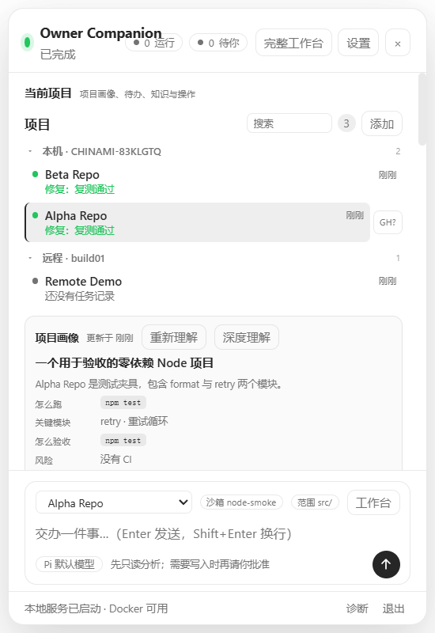

**想法**是项目的改进意见收件箱（不是任务队列，不执行）：

| 字段/动作 | 说明 |
| --- | --- |
| 标题 | 一句话描述想法 |
| 来源 | `对话`（和 Agent 讨论时自动采集）或 `手动`（输入框记下） |
| 状态 | `新想法 / 讨论中 / 已采纳 / 搁置` |
| 讨论 | 把这条想法发回 Agent 继续讨论，不改代码 |
| 采纳 / 搁置 / 重开 | 人工整理，状态流转 |
| 删除 | 从想法池移除 |

自动采集规则：消息里带「我觉得 / 建议 / 可以 / 能不能 / 希望 / 优化 / 改进」等建议语气、
且不是明确的动手指令（如「帮我改…」）时，自动进池；同一句话只保留一条。

输入框只保留「交办到… + 一句话 + 发送」，去掉了沙箱、范围、模型等 chip；
「交办到…」是这次动作的显式目标，没选时发送被拦下，不会回退到第一个项目。
分析过程中只显示一行「分析中… Ns」，结束后自动消失。
大仓库的分析会先用本地摘要（异步扫描，2.5 秒预算），分析期间窗口仍可正常交互，不会假死。

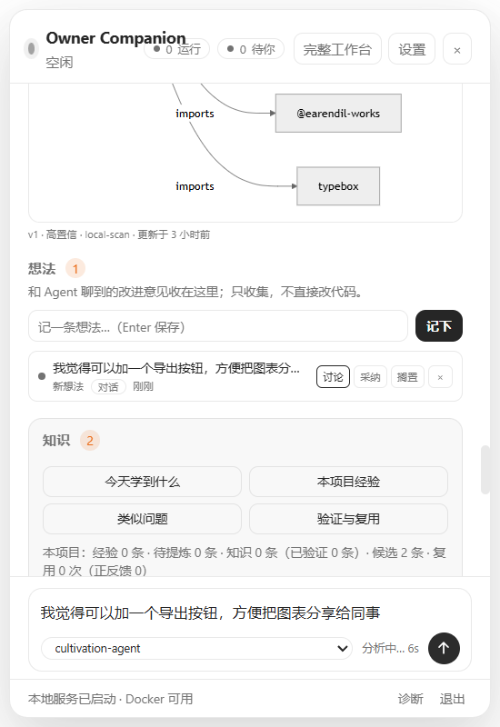

### 3.12 项目图谱（依赖 / 控制流 / 数据流 / 状态 / 时序）

在专注模式的工作区里维护项目图谱，支持五类：

| 类型 | 生成方式 |
| --- | --- |
| 依赖图 | 本地扫描 import/require/using，秒出，不调用模型 |
| 控制流图 | pstack `diagram-control`，只读分析入口/分支/循环/异常 |
| 数据流图 | pstack `diagram-dataflow`，输入/处理/存储/外部系统 |
| 状态图 | pstack `diagram-state`，状态/迁移条件/终态 |
| 时序图 | pstack `diagram-sequence`，参与者/同步异步消息/返回 |

- 模型只输出 `nodes/edges/states/transitions/participants/messages`，Mermaid 由代码生成，避免语法错误与注入；
- 每张图保存版本、来源、commit 基线、置信度与 unknowns；代码变化后提示过期；
- 依赖图自动生成；其余类型按需生成，可取消；
- 支持复制 Mermaid、导出 SVG、范围输入（`project` 或目录）；
- 生成中显示已用秒数，面板每 2 秒轮询不会把进度冲掉；
- 生成失败显示错误与重试按钮，不会白屏；
- 设置里可填「图谱备用模型」：主模型失败后自动用它重试；两个都失败才报错，并列出每次的失败原因。

大仓库提示：控制流/数据流/状态/时序都走只读模型分析，300MB 级别的仓库首次生成通常需要 40–120 秒；
主模型偶发 `session-error` / `timeout` 时，会自动换到备用模型再试一次。

生成前会先做一次本地预扫描（`buildProjectDigest`）：挑出最多 6 个最相关的源文件，带上真实行号作为摘录，
模型这次不再调用 read/grep，只基于摘录作答，因此不会被几十万文件拖到超时。

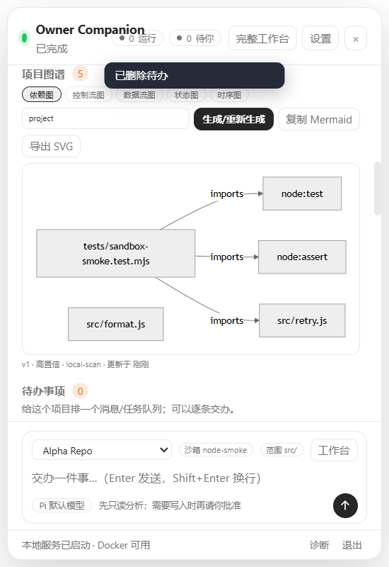

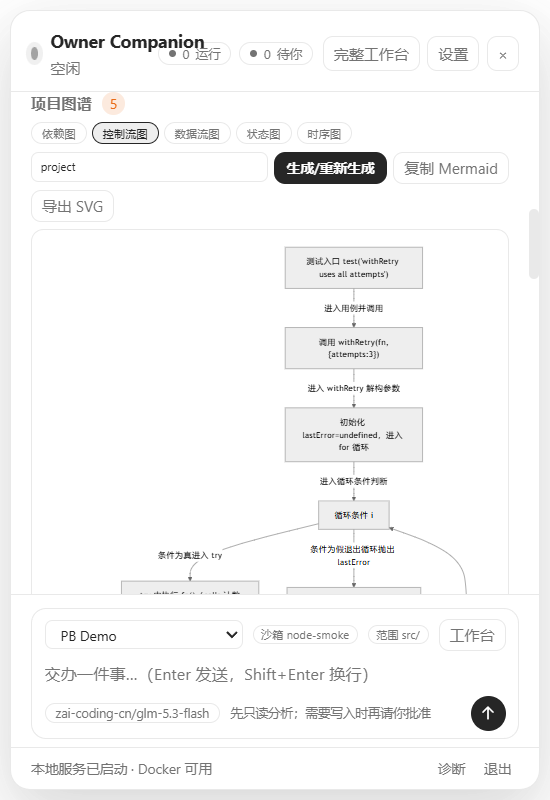

### 3.13 手机端（Cindy）

从 v0.2 起手机端使用 Cindy 的手机 App，不再维护独立 Expo 客户端：

- 桌面端安装 Owner 插件并登记项目；
- 手机与电脑登录同一 Cindy 账号、连接同一台电脑；
- 打开 Owner 插件即可看到项目、画像、想法、知识与依赖图；
- 手机页面通过宿主声明的 BroadcastChannel 与电脑上的插件通信，数据仍在电脑上。

旧的「手机连接」配对码与 47831 桥只保留在旧版 Electron 客户端里，新开发不再使用。
详见 [MOBILE.md](MOBILE.md)。


## 4. 组件清单

| 组件 | 用途 |
| --- | --- |
| 状态 pill / count chip | 运行中、需要你、错误 |
| 风险徽章 | 写请求 / 测试运行 / 高风险 |
| 步骤账本 | pending / running / done / failed / skipped |
| 工具卡片 | 工具名、耗时、输入/输出摘要、风险 |
| 计划行 | 步骤号、可编辑标签、删除/加注 |
| Diff 块 | 按风险排序的文件/知识变更 |
| 证据/来源 chip | sourceType、version、hash、availability |
| 结果页脚 | Verified / Assumed / Could not do |
| 后台 pill | 运行中数量 + 需要你数量 |

## 5. 代码映射

| 区域 | 文件 |
| --- | --- |
| Companion 首屏 | `desktop/panel.html`、`desktop/panel.js`、`desktop/panel.css` |
| 视图数据 | `desktop/main.cjs`（`buildView`、`toPending`、`chain`；按 `projectId` 取数，不读全局当前项目） |
| 模式切换 | `desktop/panel.js`（`MODE_VIEW`、`setMode`、`renderFocusMode`）；`desktop/panel.html` 的 `data-mode="focus|knowledge|chat"` |
| 视图项目 / 交办目标 | `desktop/panel-selection.cjs`（`findProject`、`viewProject`、`submitProject`）；`desktop/panel.js` 的 `viewProjectId` / `handoffProjectId` |
| 待办分组 | `desktop/pending-groups.cjs`（`groupPending`：分组顺序 + 首组展开；吃操作区模型的 items） |
| 操作区视图模型 | `src/focus-ops.mjs`（`focusOpsView`：三段块顺序、空态文案、两个计数口径）；`desktop/focus-ops-host.mjs` 把 ESM 挂到 `window.OwnerFocusOps` |
| 执行状态判定 | `src/execution-status.mjs`（终态 / 审批态 / 相位；`listInFlightExecutions` 给快照 `view.executions`） |
| 工作区入口条 | `desktop/panel.html` 的 `#workProjectBar` / `#workEntries`；`desktop/panel.js` 的 `renderWorkProjectBar` / `renderWorkEntries`（项目切换只改视图项目，「添加项目」在切换行尾） |
| 交办开关 | `desktop/chat-handoff.cjs`（`routeOf`、`sendLabel`、`consume`、`resultKind`） |
| 知识浏览 / 技能目录 | `src/knowledge/browse.mjs`、`src/knowledge/skills.mjs` |
| 知识详情 | `web/workbench/app.js`（`renderEditor`、`loadHistory`、`loadProvenance`） |
| 维护页 | `web/workbench/index.html`、`app.js`（`loadMaintenance`）、`styles.css` |
| 设计令牌 | `desktop/panel.css`、`web/workbench/styles.css` |

## 6. 不做的事

- 不把聊天记录当审计；
- 不用无限 spinner / 假进度；
- 不给破坏性动作“永远允许”；
- 不先做知识图谱；
- 不把 Letta 式开发者三栏直接塞给普通用户，保持渐进披露。

## 7. 验证

| 验收 | 结果 |
| --- | --- |
| `npm run check` | 0 |
| `npm test` | 582 tests / 578 pass / 4 skip / 0 fail |
| `npm run e2e:desktop:composer` | PASS（Composer、只读分析、无写入开关、pending） |
| `npm run e2e:desktop:shell` | PASS（桌宠定位、面板、重启、模型切换、添加项目） |
| `npm run e2e:desktop:multiproject` | PASS（多项目 pending / stage） |
| `npm run e2e:desktop:knowledge` | PASS（知识摘要、验证、复用、今日视图） |
| `npm run e2e:desktop:sandbox-config` | PASS（缺少快照文件 → 失败弹窗 → 补齐后重试） |
| `npm run e2e:desktop:mascots` | PASS（spritesheet 播放、一键换肤、静态回退、无底盘、有效帧） |
| `npm run e2e:desktop:projects` | PASS（工作区顶部项目切换、切换行尾「添加项目」、切换只改视图项目、四个入口计数随项目换、交办菜单仍列出全部项目） |
| `npm run e2e:desktop:playbooks` | PASS（运行中状态、4 个一键沉淀预设、分析、取消、手动/一键沉淀、去重、提案 HITL） |
| Workbench UI 冒烟 | 详情 5 个标签、修订对比、使用记录、维护降级提示 |
