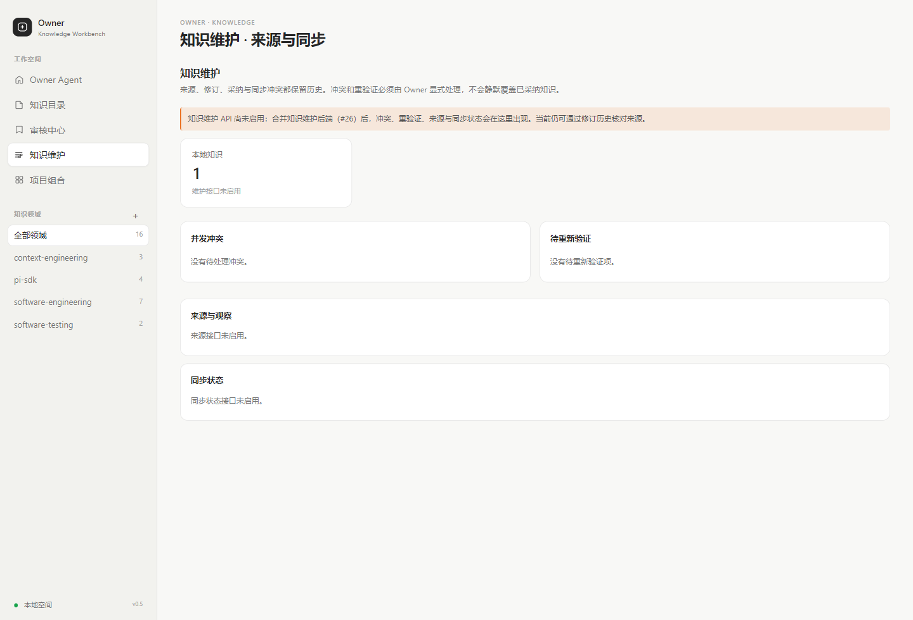
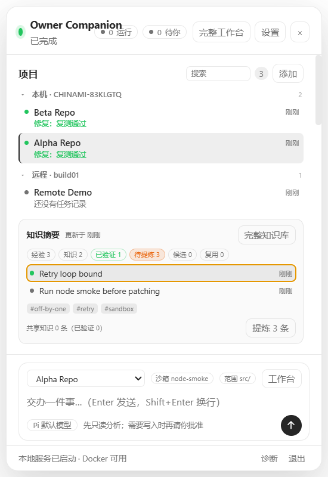
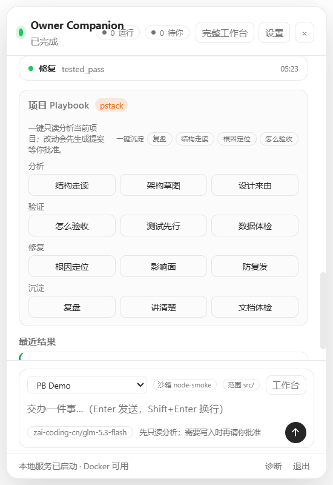
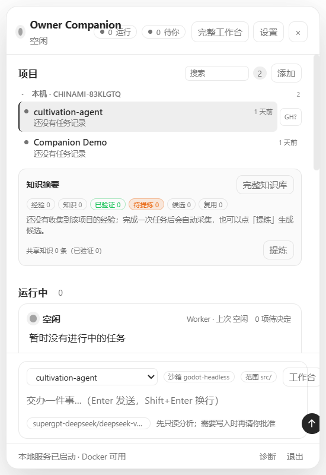

# Owner Companion / Workbench UI 方向 v1

> 目标：把“聊天式界面”升级为“任务委托 + 信任审阅”界面。保留 Cindy 的暖中性、单色 CTA 与低噪音底子，不重做产品能力。




## 1. 参考产品

| 产品 | 借鉴点 |
| --- | --- |
| Goose（本地 Agent，Desktop + CLI） | 权限模式（Auto / Smart / Approve / Chat Only）；写工具内联 Allow / Deny；Recipes 复用工作流 |
| Open WebUI Computer | `ask / auto / full` 审批模式；只读自动放行、写/命令必须批准；Plan Mode 先只读出计划 |
| Cline | Plan / Act 两态；文件修改先看 diff；checkpoint 可回滚；动作级审批 |
| Letta ADE | 左配置 / 中对话 / 右状态；Context Window Viewer、Core Memory、Archival Memory |
| OpenHands | 轨迹/事件流可视化；SecurityAnalyzer 风险分级 + ConfirmationPolicy |
| Khoj / Reor | 本地优先个人知识；搜索 + 阅读 + 来源引用，不用聊天记录代替知识浏览 |
| Setproduct Agent UI Patterns | 可编辑计划、Live Step Ledger、Tool Cards、分级权限、批量审批、暂停改道、Diff-first、Verified/Assumed/Could-not-do、Action Trail |
| Dataiku HITL | 风险分级检查点、审批审计（人/时间/理由）、审批延迟与驳回率指标 |

## 2. 设计原则

1. **任务优先**：一个任务有目标、计划、步骤、审批、结果、审计；聊天只是附属。
2. **先计划后执行**：只读分诊 → 可审阅计划 → HITL → 执行 → 补丁 → 沙箱。
3. **审批按风险分级**：读不打断；写要批准；破坏性/不可逆每次都要批准。
4. **结果先给足迹**：改了哪些文件/知识，按风险排序；再给说明。
5. **诚实结果**：固定三栏 `已验证 / 假设 / 未能完成`，不把“没跑测试”写成“完成”。
6. **可审计**：动作、来源、修订、采纳、冲突都有不可变 ID 与时间。
7. **后台可感知**：全局 pill 区分“运行中”和“需要你”，不能让任务停在看不到的地方。
8. **知识是信任记录**：正文只是一栏；来源、修订、采纳、使用、冲突同等重要。

## 3. 屏幕结构

### 3.1 Companion 首屏（任务驾驶舱）

```text
[状态 pill] 0 运行 · 1 待你
项目（顶部，按来源主机分组 + 搜索）
  组头：本机 · HOST / 远程 · HOST（可折叠）
  行：项目名 + 最近进展 + 相对时间 + 待你/进行中徽章
  知识摘要：经验/知识/已验证/待提炼计数 + 已验证优先条目 + 标签 + 提炼
需要你决定（仅有待办时出现）
  卡片：标题 + 风险徽章 + 为什么 + 批准后会发生什么 + 详情/批准/拒绝
最近任务 / 运行中
  步骤账本：任务 → 补丁 → 测试 → 修复
  每步：状态 glyph + 名称 + 详情 + 状态
Composer
  项目 / 沙箱 profile / 允许范围 / 模型 / 只读分诊提示
知识（次级）
会话 / Playbook / 最近结果
```


### 3.2 任务详情抽屉

- 目标、项目、类型、风险等级。
- 计划：3–6 步，可编辑（后续版本），当前为只读计划预览。
- 审批：展示写入意图、目标文件、允许范围、只读分析结论。
- 结果：diff 摘要 + 验证/假设/未完成。
- 动作：`去批准` / `拒绝` / `暂停改道`（后续版本）。

### 3.3 知识详情（Workbench）

Tab：`内容 | 修订 | 来源 | 使用 | 冲突`

- 内容：现有编辑表单。
- 修订：时间线 + 旧/新内容对比 + 恢复。
- 来源：`knowledgeId`、采纳修订、Head、漂移、来源版本/哈希/可用性。
- 使用：run、revision、context snapshot、outcome/benefit。
- 冲突：本地/远端/字段；解决入口。
- 维护页：冲突、待重验证、来源、同步状态；后端未启用时明确降级提示。

### 3.4 动态桌宠与一键换肤

- 支持 Cindy 静态 PNG/SVG/GIF 与 **Codex Pet 动画包**（`pet.json` + spritesheet，8×9 / 8×11）。
- 宠物直接浮在桌面上，没有白色圆盘或光环，只保留贴地阴影。
- 状态 → 精灵行：idle / running / waiting / review / failed；完成时先 `jumping` 一次再进入 `review`，换皮肤先 `waving` 一次，拖动时按方向播 `running-left/right`。
- pstack 只读分析运行期间，桌宠进入 running 并显示「pstack 正在分析：…」；完成后 3 分钟内显示完成/失败，再回到 idle。
- 每行动作的实际帧数不同（idle 6、waving 4、jumping 5…），只播有效帧，不会闪到行尾透明占位。
- 悬停工具条：`↻` 一键切到下一个皮肤、`▦` 打开皮肤选择、`×` 隐藏。
- 右键桌宠打开皮肤选择；设置页点击任意皮肤立即生效，动画包显示首帧缩略图。
- 「导入 Codex 宠物…」选择 `pet.json` 或文件夹，复制到用户目录并立即切换。


### 3.5 项目查找（按来源主机分类）

- 顶部第一屏是**项目查找**，不是卡片墙：按项目根路径推断来源主机，分为 `本机 · HOST` 与 `远程 · HOST` 两组（UNC `\\host\share`、`ssh://` / `sftp://` / `git://` 取主机名）。
- 组头可折叠，显示该来源下的项目数；本机组排在最前。
- 每行：状态点 + 项目名 + **最近一次进展**（任务 / 补丁 / 沙箱 / 修复里时间最新的一条）+ **相对时间**（刚刚 / N 分钟前 / N 小时前 / N 天前），悬停可看完整时间与根路径。
- 有待办时显示 `N 待你`，正在执行时显示 `进行中`；当前项目左侧高亮。
- 顶部搜索框按名称 / 路径 / 进展过滤；「添加」直接选择新的项目目录。
- 选中项目后，列表下方展开该项目的 **知识摘要**：
  - 计数：经验 / 知识 / 已验证 / 待提炼 / 候选 / 复用；
  - 条目：已验证知识优先，其次最近经验；点击知识打开详情；
  - 标签：该项目知识的高频标签；
  - 底部：共享知识数量与「提炼 N 条」入口。
- 切换项目时摘要跟着切换，并即时从知识库重新读取。
- 没有待决定事项时不再占用首屏，只在有审批时出现。



### 3.6 pstack 结果沉淀为项目知识

- 所有 playbook 仍然只读：不改文件、不自动开补丁。
- 结果页主操作是「**沉淀为项目知识**」：把结论、关键发现、风险/未知、下一步和证据引用写成一条 **项目级知识候选**。
- 候选状态始终是 `unverified`（`scope=project`、`layer=project`），进入项目知识摘要的「候选」计数；在完整知识库里审核后才可能变为已验证。
- 同一次 run 重复沉淀会自动去重；候选带 `pstack:<runId>` 与文件证据，可回溯。
- 「生成改动提案」降为次要操作，只在确实要改代码/文档时使用，仍然走 HITL 审批。
- 组别对应关系：`分析 / 验证 / 修复 / 沉淀` 都可以沉淀知识；「沉淀」组的复盘、讲清楚、文档体检最适合直接生成候选。
- **一键「复盘并沉淀」**：在「项目 Playbook」标题右侧或「知识」操作栏点击，直接跑 `reflect`（复盘），成功后自动沉淀为知识候选，不需要再手动点一次；失败时保留分析结果并提示原因。
- **预设按钮**：Playbook 标题行的「一键沉淀」提供 4 个预设——`复盘`、`结构走读`、`根因定位`、`怎么验收`；点击后运行对应 playbook 并自动沉淀。知识区保留「复盘并沉淀」快捷入口。




### 3.7 GitHub 关联

- 项目行自动从 `git remote get-url origin` 识别 GitHub 仓库（https / ssh / scp 写法都支持），显示 `GH` 徽章。
- 点击 `GH` 在系统浏览器打开仓库；`GH` 绿色表示 gh 已成功读取状态，`GH?` 表示已关联但状态不可读（悬停看原因）。
- 悬停可看 `owner/repo`、私有/公开、默认分支、星标、最近一次提交。
- 复用本机已登录的 **gh CLI**，不新增 token 存储；未登录时提示 `需要 gh auth login`，仓库链接仍然可用。
- 只读：不读取代码、不改动远端；创建 PR 等写操作暂不包含。
- 状态按项目根目录缓存 5 分钟，避免每次轮询都调用 GitHub。
- 项目下方「GitHub」区列出打开的 Issues / PR（各最多 5 条），点击条目在浏览器打开；显示打开总数（最多统计 20 条，超过显示 `20+`）。
- Issues/PR 列表只读、缓存 2 分钟；仓库不可读时只显示错误与仓库链接，不影响项目切换。




## 4. 组件清单

| 组件 | 用途 |
| --- | --- |
| 状态 pill / count chip | 运行中、需要你、错误 |
| 风险徽章 | 写请求 / 测试运行 / 高风险 |
| 步骤账本 | pending / running / done / failed / skipped |
| 工具卡片 | 工具名、耗时、输入/输出摘要、风险 |
| 计划行 | 步骤号、可编辑标签、删除/加注 |
| Diff 块 | 按风险排序的文件/知识变更 |
| 证据/来源 chip | sourceType、version、hash、availability |
| 结果页脚 | Verified / Assumed / Could not do |
| 后台 pill | 运行中数量 + 需要你数量 |

## 5. 代码映射

| 区域 | 文件 |
| --- | --- |
| Companion 首屏 | `desktop/panel.html`、`desktop/panel.js`、`desktop/panel.css` |
| 视图数据 | `desktop/main.cjs`（`toPending`、`chain`） |
| 知识详情 | `web/workbench/app.js`（`renderEditor`、`loadHistory`、`loadProvenance`） |
| 维护页 | `web/workbench/index.html`、`app.js`（`loadMaintenance`）、`styles.css` |
| 设计令牌 | `desktop/panel.css`、`web/workbench/styles.css` |

## 6. 不做的事

- 不把聊天记录当审计；
- 不用无限 spinner / 假进度；
- 不给破坏性动作“永远允许”；
- 不先做知识图谱；
- 不把 Letta 式开发者三栏直接塞给普通用户，保持渐进披露。

## 7. 验证

| 验收 | 结果 |
| --- | --- |
| `npm run check` | 0 |
| `npm test` | 281 tests / 278 pass / 3 skip / 0 fail |
| `npm run e2e:desktop:composer` | PASS（Composer、只读分析、无写入开关、pending） |
| `npm run e2e:desktop:shell` | PASS（桌宠定位、面板、重启、模型切换、添加项目） |
| `npm run e2e:desktop:multiproject` | PASS（多项目 pending / stage） |
| `npm run e2e:desktop:knowledge` | PASS（知识摘要、验证、复用、今日视图） |
| `npm run e2e:desktop:sandbox-config` | PASS（缺少快照文件 → 失败弹窗 → 补齐后重试） |
| `npm run e2e:desktop:mascots` | PASS（spritesheet 播放、一键换肤、静态回退、无底盘、有效帧） |
| `npm run e2e:desktop:projects` | PASS（按来源主机分组、最近进展 + 时间、知识摘要、GitHub 关联与 Issues/PR、搜索、折叠、点击切换） |
| `npm run e2e:desktop:playbooks` | PASS（运行中状态、4 个一键沉淀预设、分析、取消、手动/一键沉淀、去重、提案 HITL） |
| Workbench UI 冒烟 | 详情 5 个标签、修订对比、使用记录、维护降级提示 |
