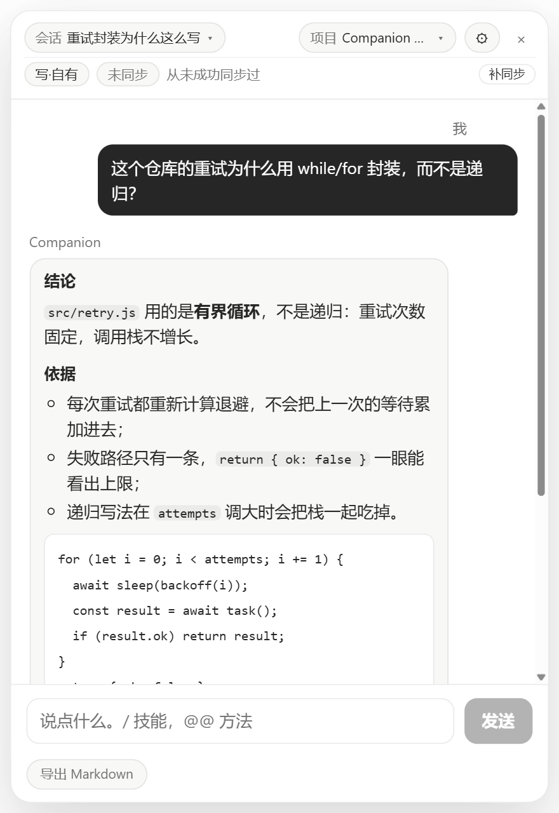

# Owner Companion v1.0.0

> 多项目、非侵入式的本地 AI 观察员。只读地理解你的仓库，把结论沉淀成项目记忆；所有写操作按目的地分级，跨出本机一律先问人。



## 这一版是什么

桌面端从「面板 + 多档位」收敛成**一个窗口、一个输入框**，并把对话真正接到了只读的 Pi 会话上：

- `/` 调用技能，按名字检索（名字前缀优先），选中后只把技能名放进输入框；
- `@@` 先指认对象，再选方法：生成 prompt、关联项目、关联会话、分享到飞书；
- 普通消息由只读 Pi 会话回答：`read / grep / find / ls`，逐字流式显示，随时可停。

## 亮点

### 对话

- **流式输出**：首字即显示；停止保留已产出部分并标「已停止」；思考过程默认折叠且不落库。
- **两种插入**：流式中可以「引导」（steer 进当前回答）或「中止」（停当前一轮并自动发出新一句）。
- **撤回上一轮**：用 Pi 自带的会话树 `navigateTree` 退回，本地一问一答一起删，问题原文放回输入框。
- **Markdown 渲染**：标题、列表、代码块、引用、链接；只建 DOM，不拼 `innerHTML`。
- **全局会话也是独立会话**：能问，但不读任何项目文件。

### 写入边界

| 目的地 | 行为 |
| --- | --- |
| 自己的记忆库 | 直接执行 + 回执 |
| 被观察的项目目录 | 每次确认；同一会话可授权 |
| 本机之外（飞书） | 每次确认，没有「以后不用问」 |
| 删除 | 永远逐条确认，没有批量 |

风险按三轴（影响面 / 可逆性 / 是否离开本机）展示，判据可折叠；评估不可用一律按高，人工改判并列追加、不覆盖原判据。

### 项目记忆与配置

- 项目库、变化窗口、发布、监控各有命令入口；发布产出 vN、导出目录与投递回执。
- 配置箱七个分区；模型行从已装模型里选（Pi 的 `models.json` / `models-store.json`），也可手填 `provider/model`；密钥只显示来源与状态。
- `/setup` 逐项探测本机，给出建议写入清单，一次确认后写盘；手改过的值不会被重新探测覆盖。

### 同步

- 先拉后推；有冲突就停下，四种处理：远端覆盖 / 本地覆盖 / 两段都留 / 跳过。
- 跳过只影响该篇，并留「未解决」标记；从未成功同步过不会显示成「已同步」。

## 安装

Windows 10/11，下载 `OwnerCompanion-1.0.0-portable.exe`，双击即用。
校验 `SHA256SUMS.txt` 后再运行；当前没有代码签名，SmartScreen 可能提示「未知发布者」。

首次启动：

1. 顶栏「会话」新建会话；
2. 顶栏「项目」选已登记项目；
3. 顶栏 ⚙ → 主模型，选一个已装模型；
4. 直接提问。

数据在 `%APPDATA%\owner-agent-mvp`；覆盖 exe 不影响数据。升级前复制整个目录即可备份。

## 从源码运行

```powershell
npm ci
npm run desktop
```

要求 Node.js ≥ 22.13。模型凭据来自 Pi 登录态（`~/.pi`）或 provider 环境变量。

## 已知限制

- 风险评估仍是规则占位，尚未接模型（#133）；
- 版本浏览与 diff、删除项目、灵感收件箱待接回新入口（#92 / #93 / #94 / #96 / #97）；
- 监控心跳目前显式触发，未做常驻调度；
- 仅支持 Windows 桌面；不提供容器镜像（原因见 `docs/DEPLOYMENT.md`）。

## 安全

- 对话工具面固定只读，创建后二次核对实际工具表；
- 外发与删除每次确认，删除逐条；
- 密钥不写入配置、不回显；
- 发现漏洞请走 GitHub 私密报告，不要开公开 issue（见 `SECURITY.md`）。

## 许可

PolyForm Noncommercial 1.0.0：源码可见、可自用与修改，禁止商业使用。严格意义上不是 OSI 开源，属于 source-available。

## 反馈

- Bug / 功能：仓库 issue 模板；
- 设计讨论：先读 `docs/adr/`，再开 issue。
